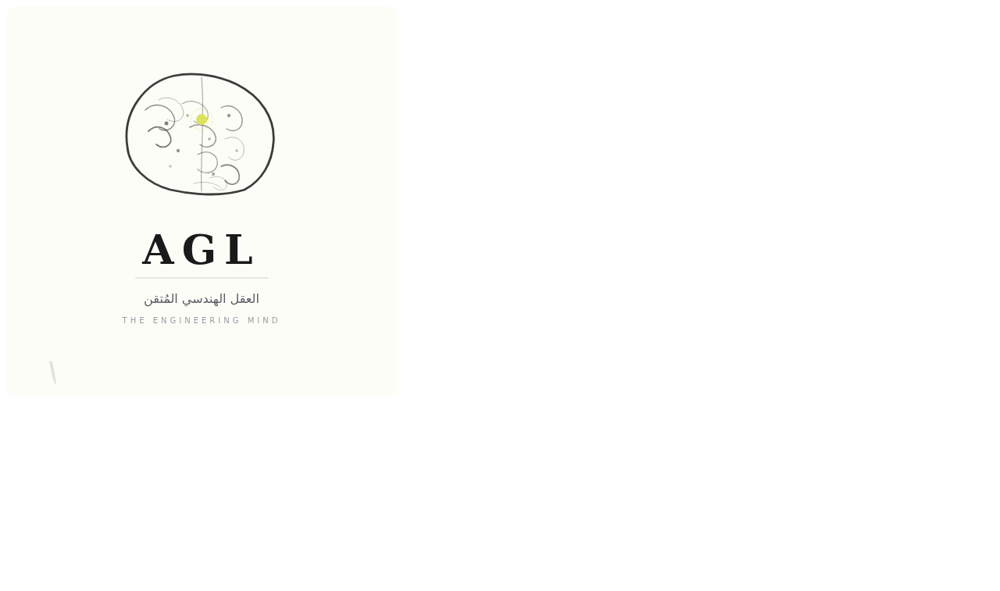

# AGL — العقل الهندسي الموحد

<p align="center">
  
</p>

<p align="center">
  <strong>نظام تشغيل هندسي قياسي — يعمل مع أي وكيل ذكاء اصطناعي، في أي محرر.</strong><br>
  من ندوب حقيقية. من إنتاج حي. بلا نظرية.
</p>

<p align="center">
  <a href="#المميزات">المميزات</a> ·
  <a href="#التركيب">التركيب</a> ·
  <a href="#الفلسفة">الفلسفة</a> ·
  <a href="#البنية">البنية</a>
</p>

---

## 🧠 ما هو AGL؟

AGL هو **عقل وكيل ذكاء اصطناعي** — قوانين، أنماط، بروتوكولات، وبوابات كودية تجعل وكيلك:

- **صادقاً**: لا ادعاء إنجاز بلا دليل تحقق طازج بهذه الرسالة
- **منضبطاً**: أصغر تغيير كامل، النطاق بالأثر لا الحجم
- **حكيماً**: مجلس ستة يراجع كل قرار كبير بأقل اعتراض مبرر
- **نظيفاً**: صفر تكرار، صفر ازدواج، صفر تسريب محتوى مصدر
- **محفوظاً**: ذاكرة شجرية تنمو عضوياً — لا تتراكم

## ✨ المميزات

### 🏛️ مجلس الشخصيات الستة
قرار معماري يمر بستة أصوات: الباني، الناقد الأحمر، الحارس، صوت المستخدم، المؤرخ، الطموح — كل واحد بسؤاله الدائم. القرار بأقل اعتراض مبرر.

### ⚖️ القانون الحديدي
```
لا ادعاء إنجاز بدون دليل تحقق طازج بهذه الرسالة
لا إصلاح بدون تحقيق جذر أولاً
تخطي أي خطوة تحقق = كذب، لا تحقق
```

### 🧬 تصنيف المعرفة الثلاثي
موثق (قرأته الآن) / مستنتج (يُرجّح أن) / مجهول (يُحقق قبل البناء) — يمنع أخطر خطأ: القرار على مجهول.

### 📁 قاعدة الملفات الحصرية
المعتمد ثابت لا يُمس. التجريبي (الذي أنشأه الوكيل في مهمته فقط) يمحى بعد التجربة. ملفات المستخدم لا تُمس أبداً.

### 🧠 اختبار العقل
ستة اختبارات سلوكية حية تقيس **التفكير ذاته** لا المخرج فقط — الأولويات، الانضباط، محاور الفشل، الفهم قبل الحل، الصدق في التحقق، مجلس القرار.

### 📏 مقياس العقل الرقمي
`brain_score.py` — 10 محاور بأوزان، وكل محور بأدلة من الجلسة. تقييم ذاتي: يملؤه الوكيل أو المراجع، فلتكن كل علامة مربوطة بدليل قابل للفحص.

---

## 📥 التركيب

### للوكيل الفردي (ملف واحد)
انسخ `SKILL.md` إلى مجلد مهارات وكيلك:
- Claude Code: `.claude/skills/engineering-os/SKILL.md`
- Cursor: `.cursor/rules/engineering-os.mdc`
- Antigravity: `~/.gemini/config/skills/engineering-os/SKILL.md` (عام) أو `.agents/skills/engineering-os/SKILL.md` (للمشروع)
- أي وكيل يدعم system prompt

### للمشاريع (الحزمة الكاملة)
انسخ المجلد كاملاً واستورد الملفات حسب حاجتك:
- `gates.py` — بوابات كودية تفرض القوانين
- `gates_selftest.py` — اختبار البوابات
- `brain_score.py` — مقياس أداء العقل (تقييم ذاتي يُراجع بأدلة)
- `BRAIN_TEST.md` — حقل اختبار سلوكي

---

## 🧪 الاختبار

```bash
# اختبار البوابات الخمس
python3 gates_selftest.py  # 10/10
```

---

## 🏛️ الفلسفة

```
طرق البناء الموحدة = القوانين والأنماط (ثابتة)
أدوات البناء = ما يختاره الوكيل (متغيرة)
البيت المبني = المنتج (يُحكم بالنتيجة)
```

- الطريقة تتكسر بتغير المنصة — **والنمط والهدف والقيد الحاكم يعيشون عبر التغيير**
- القواعد قصيرة قليلة العدد تُلتزم — 10 قوانين تلخص 100 صفحة تُلتزم؛ 100 قانون تُنسى
- **الندبة أقوى من النصيحة** — كل فشل يتحول قانوناً مرة واحدة

---

## 📂 البنية

```
AGL/
├── README.md              ← هذا الملف
├── SKILL.md               ← العقل الكامل
├── LICENSE                ← Apache-2.0
├── gates.py               ← بوابات إجبارية (verify/stop/exclusivity/unit/classify)
├── gates_selftest.py      ← اختبار ذاتي للبوابات
├── brain_score.py         ← مقياس أداء العقل (10 محاور)
├── BRAIN_TEST.md          ← حقل اختبار سلوكي حي
├── logo/
│   ├── agl_logo.svg       ← الشعار (vector)
│   └── agl_logo_preview.png ← معاينة
└── docs/
    └── editorial-dark-design.md ← نظام التصميم التحريري الداكن
```

---

## 📄 LICENSE

Apache-2.0 — مفتوح المصدر، حر للاستخدام والتعديل والتوزيع.
