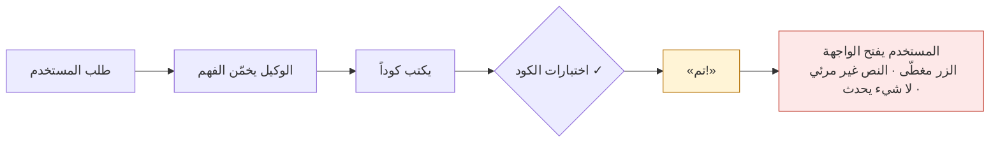
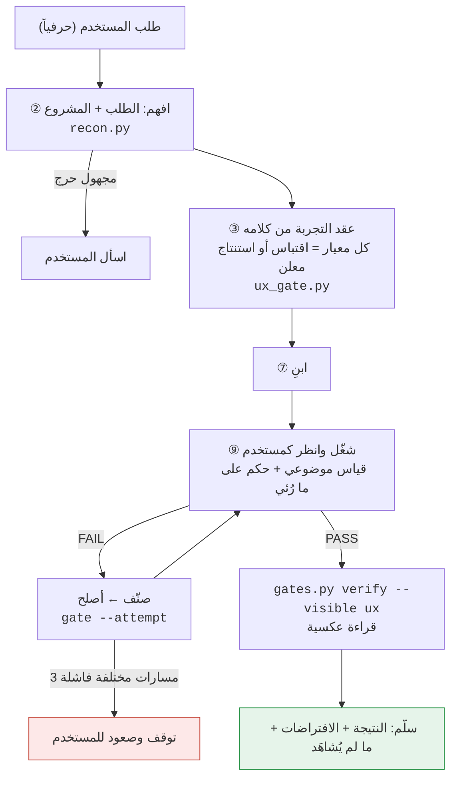

<div align="center">


# AGL — العقل الهندسي · The Engineering Mind

**يفهم طلبك ومشروعك، ثم لا يسلّم إلا ما رآه يعمل بعين المستخدم.**
*Understands your request and project first — delivers only what it has seen working through the user's eyes.*

[](https://github.com/anr466/AGL/actions/workflows/selftest.yml)
[](LICENSE)


</div>

## المشكلة · The problem



الاختبارات البرمجية تثبت أن **المنطق** صحيح، لا أن **الإنسان** يستطيع الاستخدام. والوكيل يبدأ غالباً دون أن يفهم الطلب بحروفه أو المشروع الذي يعمل فيه.

## الحل · The loop



| ما يمنعه | كيف |
|---|---|
| «تم» بلا دليل | القانون الحديدي: دليل طازج في نفس الرسالة، و`verify` يرفض القديم والفارغ |
| فهم مخمَّن | `request_parts` اقتباسات حرفية؛ معيار مجهول = سؤال، لا بناء |
| تخفيف التوقعات بعد رؤية النتائج | قفل العقد عند أول تشغيل؛ التخفيف «↓» يوقف الحكم حتى `relock` بتبرير |
| الدوران بلا نهاية | 3 مسارات **مختلفة** فاشلة = توقف؛ المسار شبه المكرر لا يُحسب |
| حذف ملفاتك | لا يُحذف إلا ما سجّله الوكيل قبل إنشائه، وما ليس في git |
| أوامر مدمرة | حراس شلّية + خطّاف Claude Code (`ask` / `deny`) |

## التثبيت · Install

```bash
git clone https://github.com/anr466/AGL.git
python3 AGL/install.py --claude --project /path/to/project   # أو بدون --claude لمسار عام
```

يطبع مقطع الخطّاف لـ`.claude/settings.json` ولا يعدّل شيئاً بنفسه. `SKILL.md` وحده يعمل في أي وكيل؛ الأدوات تضيف الفرض الآلي. المتطلبات: Python 3 فقط، و[Playwright](https://playwright.dev/python/) اختيارياً لاختبار الواجهات في المتصفح.

## ما بداخله

| الملف | الدور |
|---|---|
| `SKILL.md` | العقل: المبدأ، القوانين الستة، الحلقات التسع، المجلس، البروتوكولات |
| `references/` | تفاصيل الأدوات: `gates.md` · `user-eye.md` · `recon.md` |
| `gates.py` `jobs.py` `hook_pretooluse.py` | التحقق، الإيقاف، الحراس، مهام الخلفية، الفرض الإلزامي |
| `ux_gate.py` | عين المستخدم: عقد من الطلب + قياس + حكم + قفل |
| `recon.py` | فهم المشروع: ما هو موثق وما هو مستنتج وما هو مجهول |
| `BRAIN_TEST.md` `brain_score.py` | قياس العقل نفسه: سبعة اختبارات سلوكية و11 محوراً |

## حدود معلنة

- الحراس تحليل ساكن: لا تلتقط `eval` ولا `python -c`.
- الحكم الإدراكي ذاتي ما لم يُمرَّر `--by independent`.
- لا تغطية للمس على جهاز حقيقي، ولا قارئ الشاشة، ولا الشبكة البطيئة، ولا متصفحات غير Chromium.
- الخطّاف واختبار القياس لم يُجرَّبا إلا في بيئات اختبار، وعينات القياس صغيرة.
- مهام الخلفية POSIX فقط.

## المساهمة والرخصة

[CONTRIBUTING.md](CONTRIBUTING.md) · [MIT](LICENSE)
